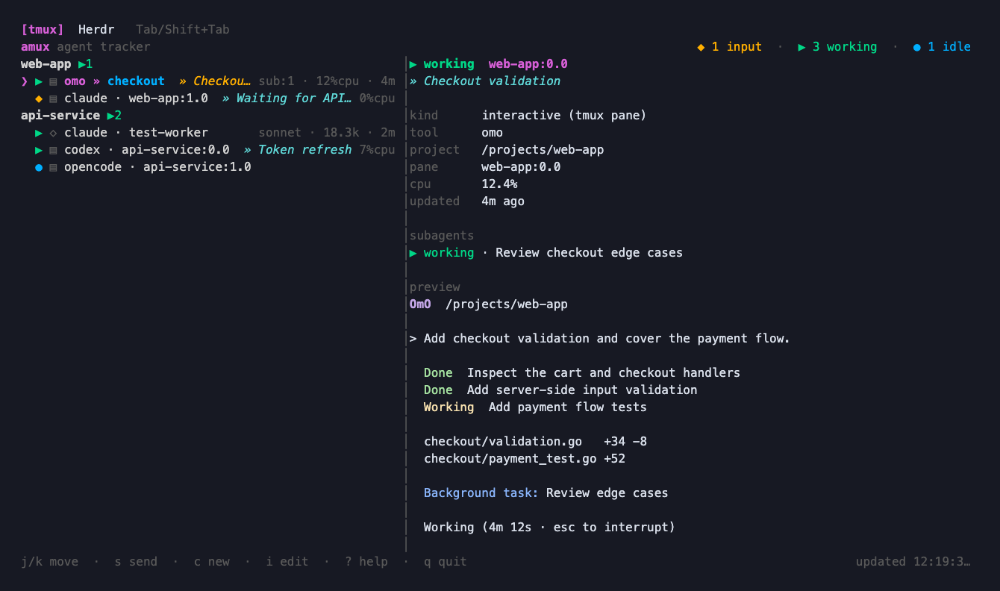
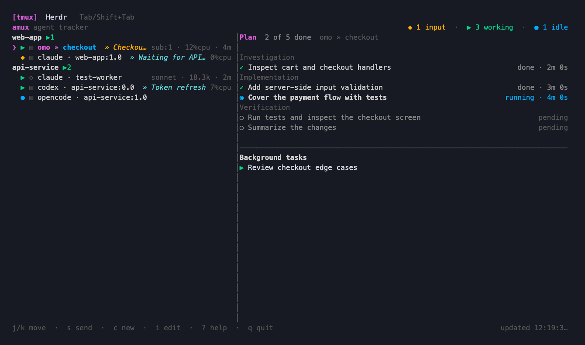

# amux

[English](README.md) | 한국어

**tmux**와 **Herdr**에서 실행 중인 AI 코딩 에이전트를 모아 보는 터미널
대시보드입니다. 살아 있는 Claude Code와 Oh My Pi 백그라운드 데몬도 함께
표시합니다.

프로젝트별 에이전트와 입력 대기 상태를 확인하고, 터미널을 미리 보고,
원하는 pane으로 이동하거나 메시지를 보내고, 새 에이전트를 실행하고,
작업 메모를 남길 수 있습니다.



이미지는 현재 amux UI에 예시 데이터를 넣어 렌더링한 화면입니다.

## 수집 대상과 주요 기능

| 수집 대상 | 지원 에이전트 | 범위 |
| --- | --- | --- |
| tmux pane | Claude Code, Codex, OmO, Oh My Pi(`omp`), OpenCode, Aider, Gemini | pane의 프로세스 트리에서 찾은 에이전트 |
| Herdr pane | 위와 같은 대화형 도구 | 실행 중인 로컬 named session의 에이전트 |
| Claude Code 백그라운드 작업 | `~/.claude/jobs`의 작업 | 소유 데몬이 살아 있는 기록만 표시 |
| Oh My Pi 백그라운드 작업 | `~/.omp/run/daemons`의 작업 | 소유 클라이언트가 살아 있는 기록만 표시 |

상단의 tmux / Herdr 탭으로 대화형 에이전트를 수집할 백엔드를 선택합니다.
백그라운드 데몬은 두 탭 모두에 표시합니다. 일반 셸과 편집기는 제외합니다.
`omp`는 Oh My Pi이며, 셸 프롬프트인 Oh My Posh와는 다릅니다.

주요 기능:

- 프로젝트별 그룹 목록과 프로젝트 이름을 붙인 단일 목록.
- 작업 중, 입력 대기, 유휴, 오류, 오래된 상태, 알 수 없음, 중지, 완료 표시.
- 색상을 유지하는 터미널 미리보기와 수집 가능한 작업·모델·토큰·CPU·경과 시간.
- Claude 하위 에이전트 수(`sub:N`)와 하위 작업 상세.
- OmO의 체크리스트 진행률, 소요 시간, 백그라운드 작업을 보여 주는 계획 패널.
- 메모 저장, 창·탭 제목 편집, 제목 프리셋.
- 에이전트 실행, 메시지 전송, pane 이동과 종료.

상태는 프로세스 정보와 도구별 터미널 표시를 분석해 판별합니다. 현재 화면을
관찰하는 방식이므로, 새로운 질문 형식이나 바뀐 화면 구성은 판별에 영향을
줄 수 있습니다. 상세 정보의 제공 범위도 도구와 수집 대상에 따라 다릅니다.

## 요구 사항과 설치

- macOS 또는 Linux.
- 빌드하려면 Go 1.24 이상.
- tmux 백엔드에는 `tmux`가 필요하며, 팝업 기능은 tmux 3.2 이상이 필요합니다.
- Herdr 백엔드에는 `PATH`에 등록된 `herdr`가 필요합니다. Herdr 0.9.5 이상을 사용합니다.
- 실행 메뉴에서 사용할 에이전트 명령이 `PATH`에 있어야 합니다.
- 선택 사항: 메모·작업 목적 제목을 생성하려면 설치 및 로그인을 마친 `codex` CLI가 필요합니다.

이 저장소를 내려받은 디렉터리에서 실행합니다.

```sh
make build
```

버전 링커 플래그를 적용해 `./amux`를 빌드하고 `~/.local/bin/amux`에도
설치합니다. `~/.local/bin`을 `PATH`에 추가하거나 `./amux`로 실행합니다.

```sh
# /usr/local/bin에도 설치합니다. 해당 디렉터리에 쓰기 권한이 필요합니다.
make install

# 다른 설치 prefix를 지정합니다.
make install PREFIX="$HOME/.local"
```

`make install`은 먼저 `make build`를 실행하므로 `~/.local/bin` 복사도
수행합니다. Makefile의 복사 위치는 `BUILD_INSTALL_PATH`로 지정할 수 있습니다.
저장소 기여자는 `AGENTS.md`에 따라 빌드 성공 후
`/Users/ky-han/.local/bin/amux`에도 복사해야 합니다.

## 빠른 시작

```sh
amux                         # 마지막으로 선택한 백엔드 복원
amux --backend tmux
amux --backend herdr
amux popup --backend tmux     # tmux 안에서 실행
amux popup --backend herdr    # Herdr 안에서 실행하면 네이티브 팝업
amux status --backend tmux --plain
```

저장된 설정이 없으면 tmux로 시작합니다. `Tab` 또는 `Shift+Tab`으로 백엔드를
전환하면 선택을 저장합니다. `--backend tmux|herdr`를 명시하면 해당 실행에서
저장된 선택보다 우선합니다.

`j` / `k` 또는 방향키로 에이전트를 고릅니다. `Enter` 다음 `f`를 누르면
해당 pane으로 이동하고, `Enter` 다음 `p`를 누르면 팝업으로 엽니다.
`?`로 단축키 도움말을 볼 수 있습니다.

## 화면과 단축키

맨 위에는 백엔드 탭이 있습니다. 기본 목록은 에이전트를 프로젝트별로 묶고,
다른 패널에는 선택한 에이전트의 상세 정보와 터미널 출력을 표시합니다.
`p`는 단일 목록 전환, `v`는 좌우·상하 배치 전환, `m`은 상세 패널 표시 전환입니다.

`l`을 누르면 상세 패널 대신 계획 체크리스트를 표시합니다. 현재 보이는 패널의
키를 다시 누르면 숨기고, 다른 패널의 키를 누르면 내용을 바꿉니다.
백엔드 선택, 화면 배치, 그룹·단일 목록 각각의 순서를 저장합니다.



화면은 2초마다 갱신합니다. 일반적인 터미널 출력 변화보다 최근에 관찰한
상태 변화를 우선해 정렬합니다. 완료·중지된 에이전트는 기본적으로 숨깁니다.
오류는 `a`로 확인 처리하기 전까지 표시하며, `d`로 이 기록들을 펼치거나
접습니다. 오류 확인과 백그라운드 에이전트 숨김은 현재 대시보드 세션에만
적용합니다.

아래 단축키는 입력창이나 메뉴가 열려 있지 않을 때 적용합니다.

| 키 | 동작 |
| --- | --- |
| `Tab` / `Shift+Tab` | tmux / Herdr 백엔드 전환 |
| `j` / `k`, `Down` / `Up` | 선택 이동 |
| `J` / `K` | 그룹 보기에서 다음 / 이전 프로젝트로 이동 |
| `g` / `G`, `Home` / `End` | 처음 / 마지막 에이전트로 이동 |
| `Enter` | pane 열기 메뉴 표시. 살아 있는 Claude 백그라운드 작업은 자체 관리 화면 열기 |
| `s` | 대화형 pane에 보낼 메시지 작성 |
| `c` | 디렉터리를 선택하고 에이전트 실행 |
| `x` | 대화형 pane 종료 확인, 또는 백그라운드 에이전트를 목록에서만 숨김 |
| `y` | 대기 중인 pane 종료 확인 |
| `/` | 저장된 메모를 포함해 에이전트 필터링 |
| `i` 다음 `t` | 창·탭 제목 편집 |
| `i` 다음 `i` | 메모 편집 |
| `I` | 메모 삭제 및 대화형 창·탭 제목을 `stay`로 변경 |
| `o` | 대화형 제목을 `start`로 바꾸고 Codex 메모 메뉴 열기 |
| `a` | 선택한 오류 확인 처리 |
| `d` | 기록 표시 / 숨김 |
| `p` | 프로젝트 그룹 / 단일 목록 전환 |
| `r` | 즉시 갱신 |
| `v` | 좌우 / 상하 배치 전환 |
| `m` | 터미널 상세 패널 표시 / 숨김 |
| `l` | 계획 체크리스트 표시 / 숨김 |
| `Esc` | 선택한 에이전트의 진행 중인 메모 생성 결과 무효화 |
| `?` | 도움말 열기. `?` 또는 `Esc`로 닫기 |
| `q` / `Ctrl+C` | 종료 |

대화형 pane 종료는 실제 pane을 닫습니다. 백그라운드 에이전트를 숨기는 동작은
현재 대시보드 목록에만 적용하며 데몬은 계속 실행합니다.
Oh My Pi 백그라운드 작업에는 연결 동작이 없습니다.

## 에이전트 열기와 복귀

### tmux

`Enter` 다음 `f`는 원래 pane을 선택하고, 필요한 경우 해당 세션에 연결합니다.
`Enter` 다음 `p`는 선택한 프로젝트의 에이전트 창들을 연결한 임시 세션을
팝업으로 엽니다. 같은 창을 공유하는 pane들은 기존 배치를 유지합니다.

프로젝트 팝업 안에서는:

- tmux prefix 다음 `n` / `p`로 창을 전환합니다.
- prefix 다음 `w`로 창을 선택합니다.
- prefix 다음 `d`로 연결을 해제하고 amux로 돌아옵니다.

원래 에이전트들은 계속 실행합니다. 이미 열린 팝업에서 에이전트를 열면
더 작은 팝업을 중첩하지 않고 기존 팝업을 사용합니다.

### Herdr

Herdr 안에서 `Enter` 다음 `f`를 누르면 선택한 에이전트의 실제 pane으로
이동합니다. `Enter` 다음 `p`는 amux의 Herdr 팝업 연동으로 터미널을 엽니다.

연결된 터미널에서 `Ctrl+Space` 다음 `d`를 누르면 에이전트를 종료하지 않고
대시보드로 돌아옵니다. Herdr의 `Ctrl+B` 다음 `q`도 연결을 해제합니다.
`Ctrl+Space` 자체를 에이전트에 보내려면 두 번 누릅니다.

네이티브 Herdr 팝업을 열 때 로컬 `amux.dashboard` 플러그인을 생성하고
연결합니다. Herdr 터미널을 tmux 팝업으로 열었다면 Herdr 기본 연결 해제 키를
사용합니다.

## 새 에이전트 실행

`c`를 누르고 `Up` / `Down`으로 이전 디렉터리나 프로젝트 디렉터리를 고르거나
경로를 직접 입력한 뒤 `Enter`를 누릅니다. `claude`, `codex`, `omo`, `omp`,
`opencode` 중 하나를 골라 다시 `Enter`를 누릅니다.

tmux에서는 선택한 에이전트의 세션에 새 창을 만들고, Herdr에서는 선택한
워크스페이스에 새 탭을 만듭니다. 사용한 디렉터리는 기록으로 저장합니다.
Aider와 Gemini는 실행 중이면 수집하지만 실행 메뉴에서는 제공하지 않습니다.

## 제목과 메모

### 제목 프리셋

`i` 다음 `t`를 누릅니다. 제목을 직접 입력하거나 `Up` / `Down`으로 프리셋을
고른 뒤 `Enter`로 적용합니다.

| 제목 편집기 안의 키 | 동작 |
| --- | --- |
| `Tab` | 입력을 가장 가까운 저장 제목으로 교체 |
| `Ctrl+N` | 현재 입력을 프리셋으로 저장 |
| `Ctrl+D` | 선택한 프리셋 삭제 |
| `Ctrl+U` | 입력 비우기 |
| `Esc` | 취소 |

초기 프리셋은 `start`, `stay`, `review`, `commit`, `gitedit`, `end`입니다.
모두 삭제한 빈 목록을 포함해 변경 사항을 저장합니다. 제목 편집은 tmux 창이나
Herdr 탭의 이름을 바꾸며, Herdr 탭이 없으면 pane 이름을 바꿉니다.

### 메모 편집과 Codex 생성

`i` 다음 `i`로 에이전트 메모를 편집합니다. `Enter`는 저장, `Ctrl+U`는
입력 비우기, `Esc`는 취소입니다. 메모는 목록과 상세 패널에 표시합니다.

대화형 에이전트에 처음 메모를 작성할 때 사용 가능한 제목 제안이 20자 이하면
Codex로 작업 목적 제목을 요청합니다. 더 긴 제안이 있으면 선택 창을 엽니다.
`y` / `Enter`는 제안 사용, `n`은 빈 메모, `o`는 Codex 요청입니다.
Codex 요청이 실패하면 오류와 사용 가능한 제안을 표시한 편집기로 돌아옵니다.

편집기를 열어 두지 않고 생성하려면:

1. `o`를 눌러 대화형 제목을 `start`로 바꾸고 Codex 메뉴를 엽니다.
2. `m`으로 모델을 고르거나, 다시 `o`를 눌러 메모를 생성합니다.
3. amux를 계속 사용하거나 종료해도 별도 작업 프로세스가 결과를 저장합니다.

모델 목록은 설치된 `codex app-server`에서 가져오고 선택을 저장합니다.
저장된 선택이 없으면 Codex 기본값을 사용합니다. 캡처한 터미널 내용을 바탕으로
생성하며, 현재는 영어 문서를 따라 사용하더라도 **한 줄의 한국어 작업 제목**을
요청합니다.

같은 에이전트의 새 요청은 이전 요청보다 우선합니다. 편집 메뉴 열기,
`I`로 메모 삭제, 선택한 에이전트에서 `Esc` 누르기는 진행 중인 생성 결과를
무효화하므로 늦게 도착한 결과가 직접 편집한 메모를 덮어쓰지 않습니다.

## 팝업 명령과 tmux 연동

```sh
# 기본 팝업 크기는 가로·세로 각각 85%입니다.
amux popup --backend tmux --width 90% --height 90%

# ~/.tmux.conf의 amux 전용 블록을 추가하거나 갱신합니다.
amux setup-keybind           # <prefix> a
amux setup-keybind A         # 대신 <prefix> A 사용
tmux source-file ~/.tmux.conf
```

`setup-keybind`는 설정 파일을 쓰며, tmux에 자동으로 다시 적용하지는 않습니다.
생성된 단축키는 저장된 백엔드로 대시보드를 엽니다.

항상 tmux 에이전트를 집계하는 tmux 상태 표시줄 설정:

```tmux
set -g status-right '#(amux status --backend tmux)'
```

`amux status`는 입력 대기, 오류, 오래된 상태, 알 수 없음, 작업 중, 유휴 순서로
0이 아닌 개수를 출력합니다. `--plain`은 tmux 색상 코드를 제거합니다.
`--backend`를 생략하면 저장된 백엔드를 사용합니다.

## 로컬 저장 데이터

플랫폼의 사용자 설정 디렉터리 아래 `amux/`에 저장합니다.

- macOS: `~/Library/Application Support/amux/`
- Linux: `$XDG_CONFIG_HOME/amux/`, 미설정 시 `~/.config/amux/`

| 파일 | 내용 |
| --- | --- |
| `preferences.json` | 백엔드, 화면 배치, 목록 순서 |
| `notes.json` | tmux 보기의 메모 |
| `herdr-notes.json` | Herdr 보기의 메모 |
| `window-titles.json` | 제목 프리셋 |
| `launch-history.json` | 이전에 선택한 실행 디렉터리 |
| `note-model.json` | 선택한 Codex 모델 |
| `herdr-plugin/herdr-plugin.toml` | 생성된 네이티브 Herdr 팝업 플러그인 |

메모 생성은 메모 저장 파일 옆에 요청 상태와 잠금 파일도 관리합니다.
메모는 에이전트 식별자에 연결되며 해당 pane이나 작업이 사라지면 정리합니다.
에이전트 프로세스를 한 번 놓치거나 pane 목록 조회에 실패했다는 이유만으로
존재하는 pane의 메모를 삭제하지 않습니다.

## 개발

```sh
go test ./...
go vet ./...
make build
```

| 디렉터리 | 역할 |
| --- | --- |
| `cmd/amux` | CLI 명령, 팝업·연결 동작, 작업 프로세스 진입점 |
| `internal/collect` | 프로세스·pane·데몬·상태·체크리스트 수집 |
| `internal/herdr` | Herdr CLI와 소켓 접근 |
| `internal/ui` | 대시보드, 메뉴, 설정, 사용자 동작 |
| `internal/notes` | 메모 저장과 생성 요청 관리 |
| `internal/notegen` | Codex 모델 조회와 메모·제목 생성 |

기여할 때는 저장소의 `AGENTS.md`를 따릅니다. 사용자에게 보이는 동작을 바꿀
때는 이 문서와 [영문 버전](README.md)을 함께 갱신합니다.
