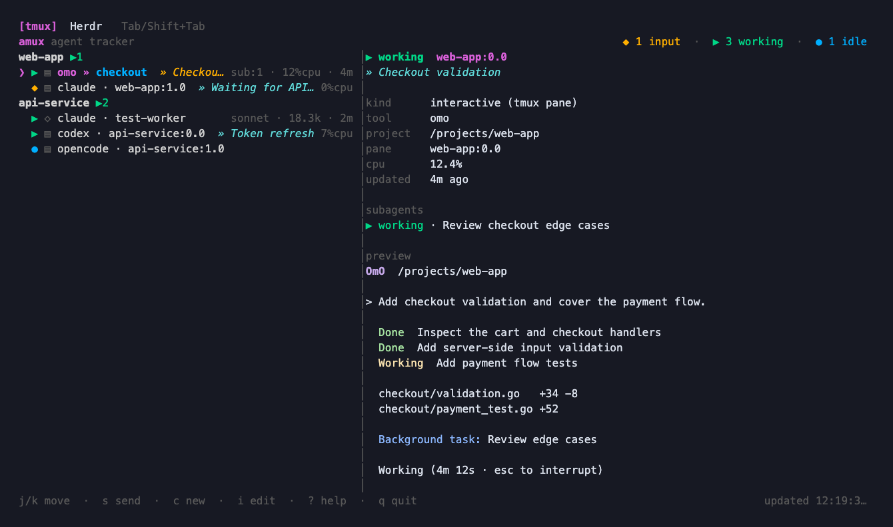
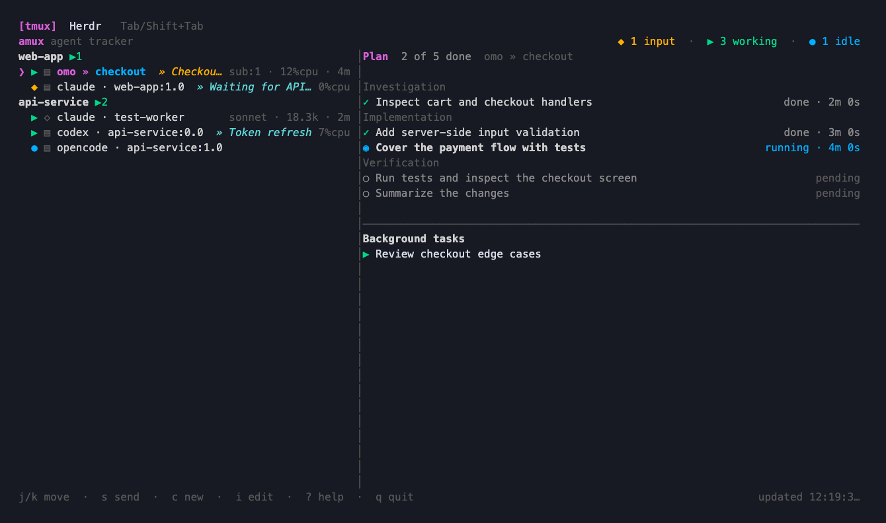

# amux

English | [한국어](README.ko.md)

A terminal dashboard for AI coding agents in **tmux** and **Herdr**, with
support for live Claude Code and Oh My Pi background daemons.

See agents by project, check which ones need input, preview their terminals,
open a pane, send a message, launch another agent, and keep notes about the work.



The screenshots use example data rendered by amux's current UI.

## What amux shows

| Source | Supported agents | Details |
| --- | --- | --- |
| tmux panes | Claude Code, Codex, OmO, Oh My Pi (`omp`), OpenCode, Aider, Gemini | Agents discovered from pane process trees |
| Herdr panes | The same interactive tools | Agents in running local named sessions |
| Claude Code background jobs | Jobs in `~/.claude/jobs` | Only records with a live owning daemon |
| Oh My Pi background tasks | Tasks in `~/.omp/run/daemons` | Only records with a live owning client |

The tmux and Herdr tabs select the interactive backend. Background daemons
appear in both tabs. Ordinary shells and editors are excluded. `omp` means
Oh My Pi, not the Oh My Posh shell prompt.

The dashboard includes:

- Project groups or a flat list with project names.
- Working, input needed, idle, error, stale, unknown, stopped, and done states.
- A color terminal preview and available task, model, token, CPU, and age details.
- Claude subagent counts (`sub:N`) and child task details.
- An OmO plan view with checklist progress, durations, and background tasks.
- Saved notes, editable window/tab titles, and reusable title presets.
- Agent launch, message sending, pane navigation, and pane termination.

Status detection uses process information and tool-specific terminal indicators.
It is an observation of the current screen, not a universal agent API; unfamiliar
prompts or changed terminal formats can affect classification. Detail fields
depend on the tool and source.

## Requirements and installation

- macOS or Linux.
- Go 1.24 or newer to build.
- `tmux` for the tmux backend; popup mode requires tmux 3.2 or newer.
- `herdr` on `PATH` for the Herdr backend; use Herdr 0.9.5 or newer.
- The agent executables you want to launch on `PATH`.
- Optional: an installed, authenticated `codex` CLI for generated notes and
  purpose titles.

From a checkout of this repository:

```sh
make build
```

This builds `./amux` with version linker flags and also installs it to
`~/.local/bin/amux`. Add `~/.local/bin` to your `PATH`, or run `./amux`.

```sh
# Also install to /usr/local/bin (requires write permission there)
make install

# Choose another install prefix
make install PREFIX="$HOME/.local"
```

`make install` runs `make build` first, so it also performs the build's copy to
`~/.local/bin`. `BUILD_INSTALL_PATH` controls that Makefile copy destination.
For repository contributors, `AGENTS.md` additionally requires copying every
successful build to `/Users/ky-han/.local/bin/amux`.

## Quick start

```sh
amux                         # restore the last selected backend
amux --backend tmux
amux --backend herdr
amux popup --backend tmux     # run inside tmux
amux popup --backend herdr    # run inside Herdr for a native popup
amux status --backend tmux --plain
```

Without a saved preference, amux starts with tmux. `Tab` or `Shift+Tab` switches
backends and saves the selection. An explicit `--backend tmux|herdr` overrides
the saved choice for that invocation.

Select an agent with `j` / `k` or the arrow keys. Press `Enter`, then `f` to
focus/open it, or `Enter`, then `p` to open it in a popup. Use `?` for help.

## Dashboard and keyboard controls

The top row selects the backend. The list groups agents by project by default;
the second panel shows the selected agent's details and terminal output.
Press `p` for a flat list, `v` to switch between side-by-side and stacked
panels, or `m` to hide/show the detail panel.

`l` replaces the detail panel with the plan checklist. Pressing the key for the
currently visible panel hides it; pressing the other key changes its content.
Backend selection, layout, and separate grouped/flat ordering are saved.



The dashboard refreshes every two seconds. Recently observed status changes
take priority over routine terminal output changes. Completed and stopped agents
are hidden by default. Errors stay visible until acknowledged with `a`; `d`
shows or hides this history. Acknowledgments and background-agent dismissals
last only for the current dashboard session.

These shortcuts apply when no input field or menu is open:

| Key | Action |
| --- | --- |
| `Tab` / `Shift+Tab` | Switch tmux / Herdr backend |
| `j` / `k`, `Down` / `Up` | Move selection |
| `J` / `K` | Next / previous project in grouped view |
| `g` / `G`, `Home` / `End` | First / last agent |
| `Enter` | Open the pane menu; for a live Claude background job, open its native agent manager |
| `s` | Compose and send text to an interactive pane |
| `c` | Choose a directory and launch an agent |
| `x` | Ask to kill an interactive pane, or dismiss a background agent locally |
| `y` | Confirm a pending pane kill |
| `/` | Filter agents, including their saved notes |
| `i` then `t` | Edit the window/tab title |
| `i` then `i` | Edit the note |
| `I` | Delete the note and set an interactive window/tab title to `stay` |
| `o` | Set an interactive title to `start` and open the Codex note menu |
| `a` | Acknowledge the selected error |
| `d` | Show / hide history |
| `p` | Switch grouped / flat view |
| `r` | Refresh immediately |
| `v` | Switch side-by-side / stacked layout |
| `m` | Show / hide terminal details |
| `l` | Show / hide the plan checklist |
| `Esc` | Invalidate pending note generation for the selected agent |
| `?` | Open help; `?` or `Esc` closes it |
| `q` / `Ctrl+C` | Quit |

Killing an interactive pane closes that pane. Dismissing a background agent
only removes it from this dashboard session; its daemon keeps running.
Oh My Pi background tasks have no attach action.

## Opening agents and returning

### tmux

`Enter` then `f` selects the original pane, attaching to its session when
necessary. `Enter` then `p` opens a temporary session that links the selected
project's agent windows. Panes that share a window keep their existing layout.

Inside the project popup:

- Use your tmux prefix, then `n` / `p`, to change windows.
- Use your prefix, then `w`, to choose a window.
- Use your prefix, then `d`, to detach and return to amux.

The original agents stay running. Opening an agent from an existing popup
reuses that popup instead of nesting a smaller one.

### Herdr

Inside Herdr, `Enter` then `f` focuses the selected agent's actual pane.
`Enter` then `p` opens the terminal through amux's Herdr popup integration.

In that attached terminal, press `Ctrl+Space`, then `d`, to return to the
dashboard without stopping the agent. Herdr's `Ctrl+B`, then `q`, also detaches.
Press `Ctrl+Space` twice to send a literal `Ctrl+Space`.

amux generates and links the local `amux.dashboard` plugin when opening a
native Herdr popup. If you open a Herdr terminal through a tmux popup instead,
use Herdr's native detach keys.

## Launching an agent

Press `c`, choose a remembered/project directory with `Up` / `Down` or type a
path, and press `Enter`. Choose `claude`, `codex`, `omo`, `omp`, or `opencode`,
then press `Enter` again.

amux creates a tmux window in the selected agent's session, or a Herdr tab in
the selected workspace. The directory history is saved. Aider and Gemini are
detected when running, but are not offered by the launch menu.

## Titles and notes

### Title presets

Press `i`, then `t`. Type a title or select a preset with `Up` / `Down`, then
press `Enter` to apply it.

| Key in the title editor | Action |
| --- | --- |
| `Tab` | Replace input with the closest saved title |
| `Ctrl+N` | Save the current input as a preset |
| `Ctrl+D` | Delete the highlighted preset |
| `Ctrl+U` | Clear input |
| `Esc` | Cancel |

The initial presets are `start`, `stay`, `review`, `commit`, `gitedit`, and
`end`. Changes persist, including an intentionally empty preset list.
Titles rename the tmux window or the Herdr tab (pane when no tab is available).

### Notes and Codex generation

Press `i`, then `i`, to edit an agent's note. `Enter` saves, `Ctrl+U` clears the
input, and `Esc` cancels. Notes appear in the list and detail panel.

For a new interactive note, amux requests a Codex purpose title when the
available title suggestion is 20 characters or shorter. Longer available
suggestions open a choice: `y` / `Enter` to prefill, `n` for a blank note, or `o`
to ask Codex. A failed Codex request returns to the editor with an error and
the available suggestion.

For generation without keeping the editor open:

1. Press `o` to set the interactive title to `start` and open the Codex menu.
2. Press `m` to select a model, or `o` again to generate the note.
3. Continue using or close amux; the detached worker saves its result.

Model choices come from the installed `codex app-server` and are remembered.
With no saved choice, Codex uses its default. Generation uses captured terminal
content and currently asks Codex for a **single-line Korean task title**, even
when following this English guide.

A new request supersedes an older one for that agent. Opening the edit menu,
deleting the note with `I`, or pressing `Esc` on the selected agent invalidates
pending generation so a late result cannot replace a manual edit.

## Popup command and tmux integration

```sh
# Default popup size is 85% by 85%
amux popup --backend tmux --width 90% --height 90%

# Add or update amux's marked block in ~/.tmux.conf
amux setup-keybind           # <prefix> a
amux setup-keybind A         # <prefix> A instead
tmux source-file ~/.tmux.conf
```

`setup-keybind` writes the configuration file; it does not reload tmux for you.
The generated binding opens the dashboard using its saved backend.

For a tmux status bar that always reports tmux agents:

```tmux
set -g status-right '#(amux status --backend tmux)'
```

`amux status` prints nonzero input, error, stale, unknown, working, and idle
counts, in that order. `--plain` removes tmux color codes. Omitting `--backend`
uses the saved backend.

## Local data

amux stores configuration under `amux/` in the platform user configuration
directory:

- macOS: `~/Library/Application Support/amux/`
- Linux: `$XDG_CONFIG_HOME/amux/`, or `~/.config/amux/`

| File | Contents |
| --- | --- |
| `preferences.json` | Backend, layout, and remembered list ordering |
| `notes.json` | tmux-view notes |
| `herdr-notes.json` | Herdr-view notes |
| `window-titles.json` | Title presets |
| `launch-history.json` | Previously selected launch directories |
| `note-model.json` | Selected Codex model |
| `herdr-plugin/herdr-plugin.toml` | Generated native Herdr popup plugin |

Note generation also maintains request and lock files beside its note store.
Notes are tied to agent identities and pruned when the corresponding pane/run
disappears. A missed agent-process detection or a failed pane inventory does
not by itself delete an existing pane's notes.

## Development

```sh
go test ./...
go vet ./...
make build
```

| Directory | Responsibility |
| --- | --- |
| `cmd/amux` | CLI commands, popup/attach actions, worker entrypoints |
| `internal/collect` | Process, pane, daemon, lifecycle, and checklist collection |
| `internal/herdr` | Herdr CLI and socket access |
| `internal/ui` | Dashboard, menus, preferences, and user actions |
| `internal/notes` | Note persistence and generation coordination |
| `internal/notegen` | Codex model discovery and note/title generation |

Follow the repository's `AGENTS.md` when contributing. Keep this document and
[the Korean version](README.ko.md) in sync when user-facing behavior changes.
